## 🌟 Animated Hero

<!-- Hero Banner with Data Network Visualization -->

<!-- Typing Animation Headline -->

 

<!-- Social Links -->

I'm a Computer Science Engineer focused on Data Science, Analytics, and Machine Learning. I work with Python, SQL, and data-driven applications to explore datasets, uncover insights, and build practical solutions.

---

## 🛠️ Focused Technical Skills

<strong>Programming &amp; Data</strong>

| Python | SQL | Pandas | NumPy |
|:---:|:---:|:---:|:---:|
|  |  |  |  |

<strong>Data Analytics</strong>

Exploratory Data Analysis • Data Cleaning • Data Preprocessing • Statistical Analysis • Data Visualization • Power BI

<strong>Machine Learning &amp; AI</strong>

| Scikit-learn | XGBoost | Deep Learning | NLP |
|:---:|:---:|:---:|:---:|
|  |  |  |  |

<strong>Tools &amp; Development</strong>

| Git | GitHub | Jupyter | Flask | MySQL |
|:---:|:---:|:---:|:---:|:---:|
|  |  |  |  |  |

---

## 📊 GitHub Activity

Contributions, development activity, and open-source work.

<!-- Contribution Graph -->

 

<!-- GitHub Statistics -->

---

## 🤝 Let's Connect

I'm interested in opportunities involving Data Analytics, Data Science, Machine Learning, and data-driven application development.

Building practical solutions with data, Python, and machine learning ⚡
